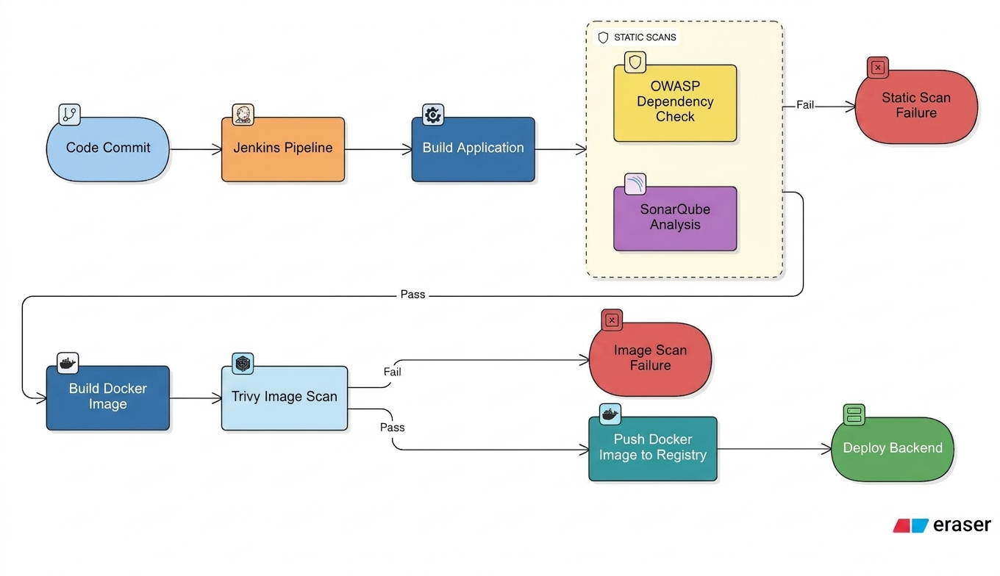
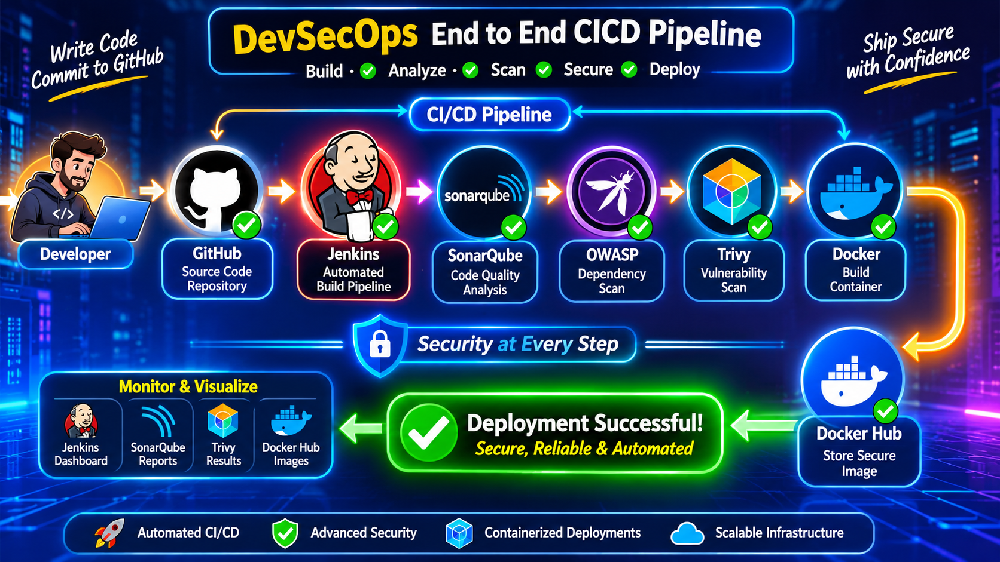

# DevSecOps End-to-End CI/CD Pipeline

An automated CI/CD pipeline integrating Jenkins, SonarQube, OWASP, 
Trivy, and Docker to build, scan, secure, and deploy applications.

Prerequisites – Required Tools
1. GitHub: Source code management and repository hosting.
2. Docker: Containerization and application image building.
3. Jenkins: CI/CD pipeline automation.
4. SonarQube: Code quality analysis and security checks.
5. OWASP Dependency-Check: Dependency vulnerability scanning.
6. Trivy: Docker image vulnerability scanning.
7. Docker Hub: Store and publish Docker images.
Operating System: Ubuntu Linux.

