# DevSecOps End-to-End CI/CD Pipeline

An automated CI/CD pipeline integrating Jenkins, SonarQube, OWASP, Trivy, and Docker to build, scan, secure, and deploy applications.


#  Table of Contents

1. [Project Overview](#project-overview)
2. [Project Architecture](#project-architecture)
3. [Prerequisites – Required Tools and Their Explanations](#prerequisites--required-tools-and-their-explanations)
4. [Prerequisites to Implement This Project](#prerequisites-to-implement-this-project)

5. [Docker and Docker Compose Installation](#1-installation-of-docker-and-docker-compose)
   - [Update Ubuntu Packages](#step-1-update-ubuntu-packages)
   - [Install Docker and Docker Compose](#step-2-install-docker-and-docker-compose)
   - [Enable Docker](#step-3-enable-docker)
   - [Allow Docker Without Sudo](#step-4-allow-docker-without-sudo)
   - [Verify Installation](#step-5-verify-installation)

6. [Jenkins Installation and Configuration](#jenkins-installation)
   - [Why Do We Use Jenkins?](#why-do-we-use-jenkins)
   - [Jenkins Configuration](#jenkins-configuration)
   - [Access Jenkins Through Browser](#access-jenkins-through-browser)
   - [Initial Administrator Password](#initial-administrator-password)
   - [Install Suggested Plugins](#install-suggested-plugins)
   - [Jenkins Homepage](#jenkins-homepage)

7. [Jenkins Plugins Installation](#2-jenkins-plugins-installation)

8. [SonarQube Installation and Configuration](#sonarqube-installation)
   - [Run SonarQube Using Docker](#run-sonarqube-using-docker)
   - [Access SonarQube Through Browser](#access-sonarqube-through-browser)
   - [SonarQube Login, Dashboard and Configuration](#sonarqube-login-dashboard-and-configuration)
   - [SonarQube Integration with Jenkins](#sonarqube-integration-with-jenkins)

9. [Trivy Installation](#trivy-installation)
   - [Install Trivy on Ubuntu](#install-trivy-on-ubuntu)
   - [Verify Trivy Installation](#verify-trivy-installation)

10. [Trivy Important Commands](#trivy-important-commands)
    - [Check Trivy Version](#1-check-trivy-version)
    - [Scan a Docker Image](#2-scan-a-docker-image)
    - [Scan High and Critical Vulnerabilities](#3-scan-high-and-critical-vulnerabilities)
    - [Scan Project Files](#4-scan-project-files)
    - [Scan Dockerfile Configuration](#5-scan-dockerfile-configuration)
    - [Generate a JSON Report](#6-generate-a-json-report)

11. [SonarQube Integration with Jenkins – Practical Implementation](#3-sonarqube-integration-with-jenkins)
    - [Install SonarQube Scanner Plugin](#step-1-install-sonarqube-scanner-plugin)
    - [Generate SonarQube Authentication Token](#step-2-generate-sonarqube-authentication-token)
    - [Add SonarQube Credentials in Jenkins](#step-3-add-sonarqube-credentials-in-jenkins)
    - [Configure SonarQube Server in Jenkins](#step-4-configure-sonarqube-server-in-jenkins)
    - [Configure SonarQube Scanner](#step-5-configure-sonarqube-scanner)
    - [Create SonarQube Project](#step-6-create-sonarqube-project)

12. [OWASP Dependency-Check Installation](#7-dependency-check-installation)

13. [Jenkins Pipeline Job Configuration](#create-a-jenkins-pipeline-job--practical-steps)

14. [Complete Jenkinsfile Implementation](#complete-jenkins-file-to-implement-the-project)

15. [GitHub Webhook Configuration](#github-webhook-configuration)

16. [CI/CD Pipeline Execution](#ci-cd-pipeline-execution)

17. [SonarQube Quality Gate Analysis](#sonarqube-quality-gate-analysis)

18. [OWASP Dependency-Check Security Reports](#owasp-dependency-check-security-reports)

19. [Trivy Security Scan Reports](#trivy-security-scan-reports)

20. [Docker Image Build and Deployment](#docker-image-build-and-deployment)

21. [Docker Hub Integration](#docker-hub-integration)

22. [Accessing the Web Application](#accessing-the-web-application)

23. [Troubleshooting Common Errors](#troubleshooting-common-errors)

24. [Final Project Results](#final-project-results)

25. [Security Best Practices](#security-best-practices)

26. [Future Improvements](#future-improvements)

27. [Official Documentation and References](#official-documentation-and-references)


---

## Project Architecture


## Prerequisites – Required Tools and Their Explanations

1. **GitHub:** Source code management and repository hosting.
2. **Docker:** Containerization and application image building.
3. **Jenkins:** CI/CD pipeline automation.
4. **SonarQube:** Code quality analysis and security checks.
5. **OWASP Dependency-Check:** Dependency vulnerability scanning.
6. **Trivy:** Docker image vulnerability scanning.
7. **Docker Hub:** Store and publish Docker images.

**Operating System:** Ubuntu Linux.

## Prerequisites to Implement This Project

- Ubuntu Linux (AWS EC2 or local machine).
- GitHub account and repository.
- Docker and Docker Compose installed.
- Jenkins installed and configured.
- SonarQube installed.
- OWASP Dependency-Check configured.
- Trivy installed.
- Docker Hub account.

---

# 1. Installation of Docker and Docker Compose

### Step 1: Update Ubuntu Packages

```bash
sudo apt update
```

### Step 2: Install Docker and Docker Compose

```bash
sudo apt install docker.io -y
sudo apt install docker-compose-v2 -y
```

### Step 3: Enable Docker

```bash
sudo systemctl enable docker
sudo systemctl start docker
```

### Step 4: Allow Docker Without Sudo

#### First, check Docker permissions:

```bash
docker ps
```

If you get a permission error, run this command to add your current user to the Docker group:

```bash
sudo usermod -aG docker $USER
```

Restart your system:

```bash
sudo reboot
```

After restarting, verify Docker:

```bash
docker ps
```

Log out and log back in for the group change to take effect.

### Step 5: Verify Installation

```bash
docker --version
docker compose version
docker run hello-world
```

**Official Documentation:** https://docs.docker.com/engine/install/ubuntu/

---

## Jenkins Installation

Install Jenkins on Ubuntu using the official documentation.

First, install Java because Jenkins requires Java to run. Follow the official documentation linked below for installation instructions.

[Official Jenkins Installation Guide](https://www.jenkins.io/doc/book/installing/linux/)

### Why Do We Use Jenkins?

Jenkins is used to automate the CI/CD pipeline, including application building, testing, security scanning, and deployment.

### Jenkins Configuration

- Jenkins runs on port **8080** by default.
- If you are using an AWS EC2 instance, allow inbound traffic on port **8080** in the Security Group.
- Start Jenkins:

```bash
sudo systemctl start jenkins
```

- Check Jenkins service status:

```bash
sudo systemctl status jenkins
```

### Access Jenkins Through Browser

Allow port **8080** in your EC2 instance's Security Group.

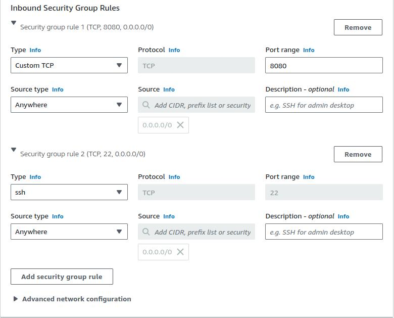

Open Jenkins in your browser using your EC2 public IP or your local IP.

```text
http://YOUR-EC2-PUBLIC-IP:8080
```

### Initial Administrator Password

Open the terminal of your local machine or AWS EC2 instance and run the following command to retrieve the initial administrator password:

```bash
sudo cat /var/lib/jenkins/secrets/initialAdminPassword
```

Copy the displayed password and paste it into the **Administrator Password** field on the Jenkins setup page to unlock Jenkins.

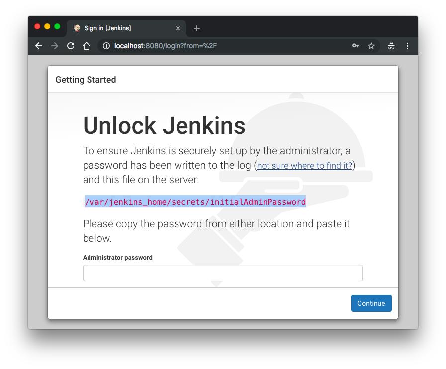

Enter this password on the Jenkins setup page to unlock Jenkins.

### Install Suggested Plugins

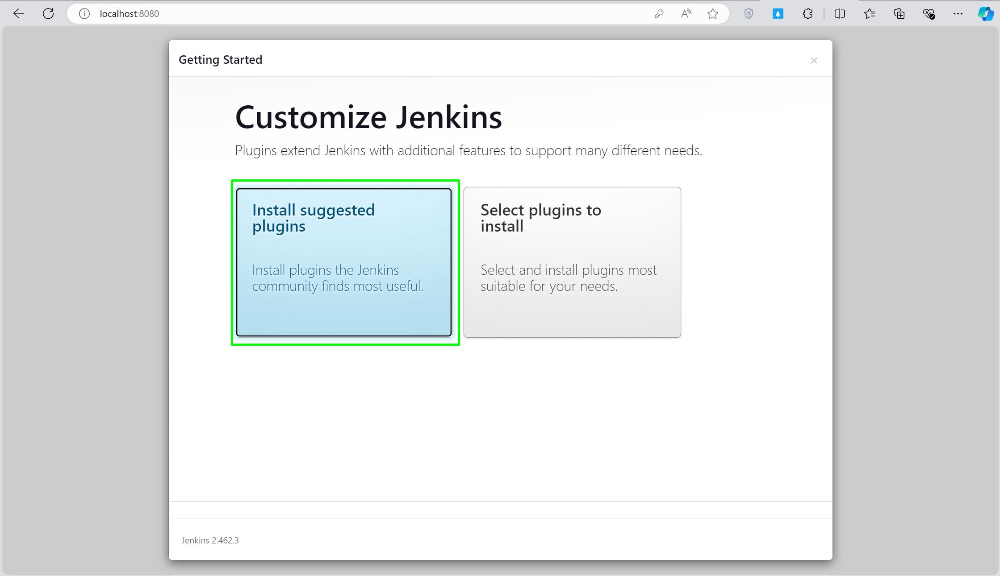

### Jenkins Homepage

The Jenkins Dashboard is the main interface for managing CI/CD pipelines and automation jobs.

Important components:

- **New Item:** Create a new Jenkins job or pipeline.
- **Build History:** View previous and current builds.
- **Manage Jenkins:** Configure Jenkins settings, plugins, credentials, and security.
- **My Views:** Organize and manage Jenkins jobs.
- **Build Executor Status:** Check available executors and running builds.
- **People:** View Jenkins users.

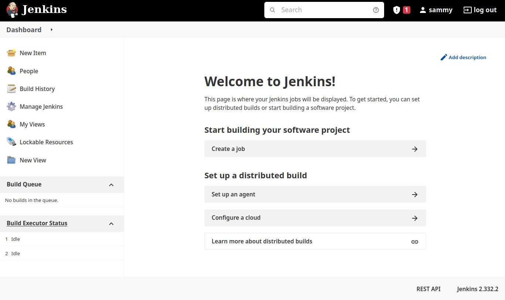

After this, we will use Jenkins to automate our pipelines.

Now, let's install the other prerequisites.

---

## 2. Jenkins Plugins Installation

Go to **Manage Jenkins → Plugins → Available Plugins** and install the following plugins required for our DevSecOps CI/CD pipeline:

1. **SonarQube Scanner** (Version 2.16.1)
2. **Sonar Quality Gates** (Version 1.3.1)
3. **OWASP Dependency-Check** (Version 5.4.3)
4. **Docker** (Version 1.5)

These plugins enable Jenkins to integrate with SonarQube, perform dependency vulnerability scanning, and manage Docker operations.

---

## SonarQube Installation

SonarQube is used to analyze source code, detect bugs, identify security vulnerabilities, and maintain code quality.

### Run SonarQube Using Docker

```bash
docker run -itd --name sonarqube -p 9000:9000 sonarqube:lts-community
```

Check the running container:

```bash
docker ps
```

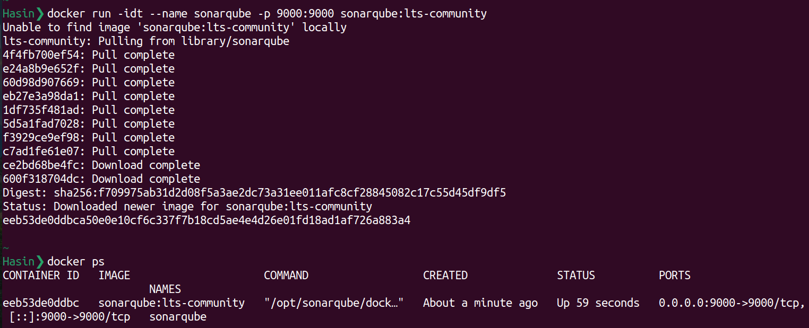

### Access SonarQube Through Browser

```text
http://YOUR-EC2-PUBLIC-IP:9000
```

### SonarQube Login, Dashboard and Configuration

- Open SonarQube in your browser using port **9000**.
- Default username: `admin`
- Default password: `admin`
- Change the default password after your first login.
- Create a project and generate an authentication token for Jenkins integration.

**Note:** If using AWS EC2, allow inbound traffic on port **9000** in the Security Group.

### Short Definition

SonarQube is a tool that checks our code, finds mistakes and security problems, and helps us write clean, secure, and better-quality code.

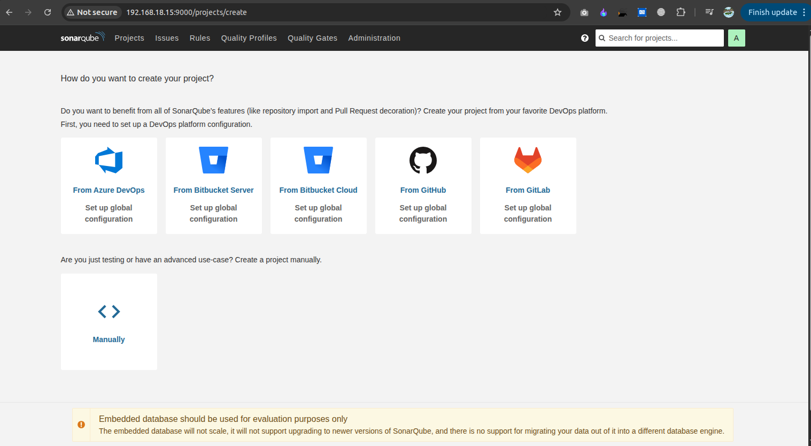

### SonarQube Integration with Jenkins

1. Install the SonarQube Scanner plugin in Jenkins.
2. Add your SonarQube server URL in Jenkins configuration.
3. Generate a SonarQube authentication token and add it to Jenkins Credentials.
4. Configure the SonarQube Scanner in your Jenkins pipeline using a Jenkinsfile.
5. Jenkins will automatically send your application code to SonarQube for quality and security analysis.

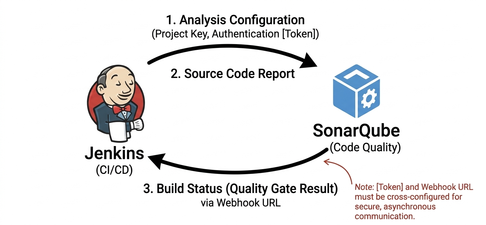

---

## Trivy Installation

Trivy is a security scanner used to detect vulnerabilities in Docker images, dependencies, and file systems.

### Install Trivy on Ubuntu

```bash
sudo apt-get install wget gnupg -y

wget -qO - https://aquasecurity.github.io/trivy-repo/deb/public.key | gpg --dearmor | sudo tee /usr/share/keyrings/trivy.gpg > /dev/null

echo "deb [signed-by=/usr/share/keyrings/trivy.gpg] https://aquasecurity.github.io/trivy-repo/deb generic main" | sudo tee -a /etc/apt/sources.list.d/trivy.list

sudo apt-get update

sudo apt-get install trivy -y
```

### Verify Trivy Installation

```bash
trivy --version
```

### Official Documentation

[Trivy Official Installation Guide](https://www.trivy.dev/docs/latest/getting-started/installation/)

---

## Trivy Important Commands

Trivy is used to scan Docker images, filesystems, and configurations to identify security vulnerabilities.

### 1. Check Trivy Version

```bash
trivy --version
```

### 2. Scan a Docker Image

```bash
trivy image nginx:latest
```

### 3. Scan High and Critical Vulnerabilities

```bash
trivy image --severity HIGH,CRITICAL nginx:latest
```

### 4. Scan Project Files

```bash
trivy fs .
```

### 5. Scan Dockerfile Configuration

```bash
trivy config Dockerfile
```

### 6. Generate a JSON Report

```bash
trivy image --format json -o trivy-report.json nginx:latest
```

**Purpose:** Trivy helps us identify security vulnerabilities before deploying our applications.

**Official Documentation:** https://trivy.dev/docs/latest/

---

# 3. SonarQube Integration with Jenkins

SonarQube is integrated with Jenkins to automatically analyze application code, detect bugs, security vulnerabilities, and check code quality during the CI/CD pipeline.

### Step 1: Install SonarQube Scanner Plugin

1. Open Jenkins Dashboard.
2. Go to **Manage Jenkins → Plugins → Available Plugins**.
3. Search for **SonarQube Scanner**.
4. Install the plugin.
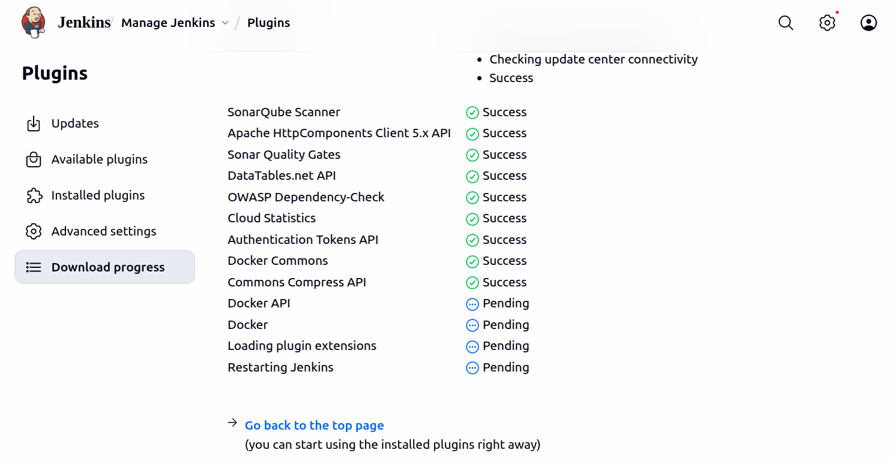

### Step 2: Generate SonarQube Authentication Token

1. Open SonarQube in your browser.
2. Log in to your SonarQube account.
3. Go to **Administration → Security → Users**.
4. Generate a new token.
5. Copy and securely save the token.
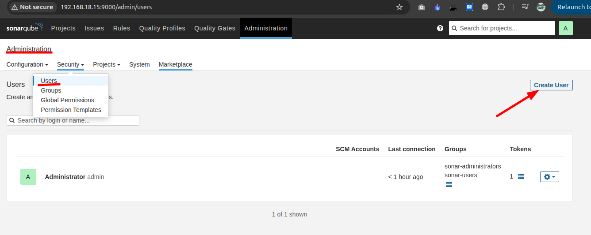

### Step 3: Add SonarQube Credentials in Jenkins

1. Open **Manage Jenkins → Credentials**.
2. Select **System → Global credentials**.
3. Click **Add Credentials**.
4. Select **Secret Text**.
5. Paste your SonarQube token.
6. Give it an ID: `sonarqube-token`.
7. Click Save.
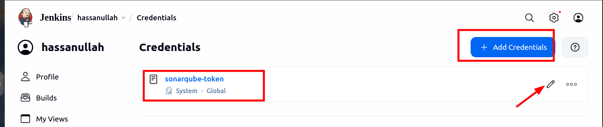


### Step 4: Configure SonarQube Server in Jenkins

1. Go to **Manage Jenkins → System**.
2. Find the **SonarQube Servers** section.
3. Click **Add SonarQube**.
4. Enter the following details:

| Setting | Value |
|---|---|
| Name | SonarQube |
| Server URL | http://YOUR-EC2-IP:9000 |
| Authentication Token | sonarqube-token |

5. Click **Save**.
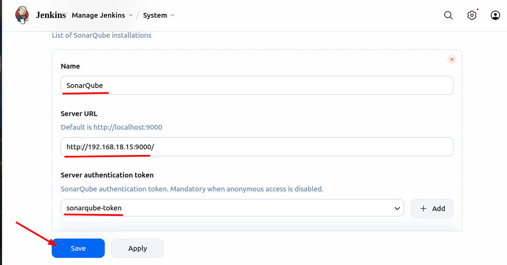

### Step 5: Configure SonarQube Scanner

1. Go to **Manage Jenkins → Tools**.
2. Find **SonarQube Scanner installations**.
3. Click **Add SonarQube Scanner**.
4. Enter the name: `Sonar`.
5. Select automatic installation if required.
6. Save the configuration.
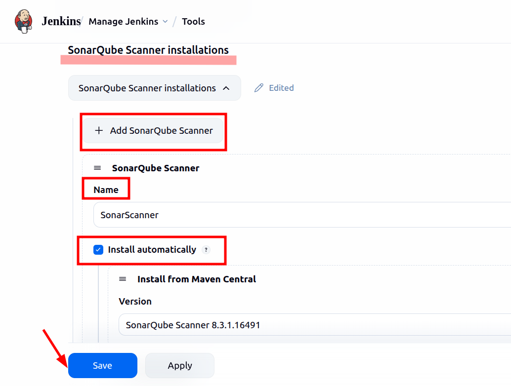

### Step 6: Create SonarQube Project

1. Open SonarQube Dashboard.
2. Click **Create Project**.
3. Select manually.
4. Enter the project name: `devsecops-python-cicd`.
5. Set the project key: `devsecops-python-cicd`.
6. Create the project.
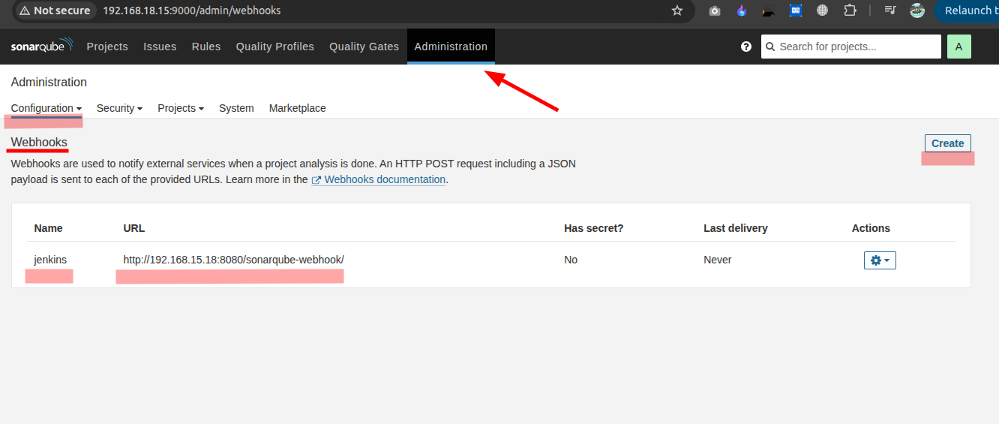

==============

### 7: Dependency Check installation
1. Open Jenkins Dashboard.
2. Go to `Manage Jenkins` → `Tools.`
3. Find `Dependency-Check installations`.
4. Click Add `Dependency-Check`.
5. Enter the following:
Setting	    Value
Name	    dc

Install  automatically	Checked
Version	Select an available version

6. Click Save.

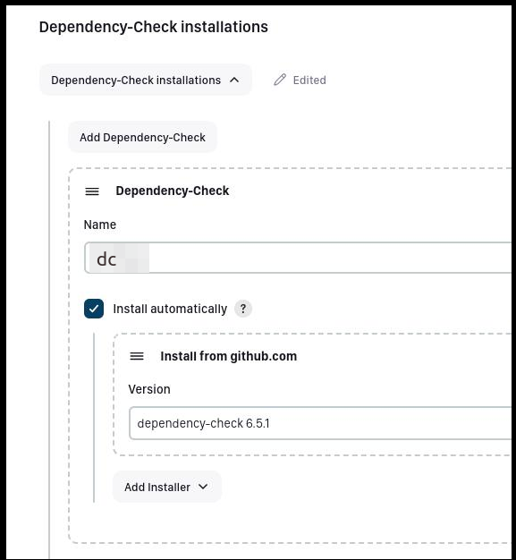


# Complete Jenkins file to implement the project

Use the following stage in your Jenkins pipeline:

Create a Jenkins Pipeline Job – Practical Steps
1. Open Jenkins Dashboard.
2. Click New Item.
3. Enter Project Name: devsecops-cici.
4. Select Pipeline.
5. Click OK.
6. Under Build Triggers, enable:
   - [x] Throttle builds (Maximum concurrent builds: 1)
   - [x] GitHub hook trigger for GITScm polling
7. Under General, set Display Name:
   devsecops-cici
8. start wrting piplines

```groovy
pipeline {
    agent any

    environment {
        SONAR_HOME = tool "Sonar"
    }

    stages {
        stage("Code Clone from Github") {
            steps {
                git url: "https://github.com/hasinUllah565/devsecops-python-cicd.git", branch: "main"
            }
        }

        stage("SonarQube Quality Analysis") {
            steps {
                withSonarQubeEnv("Sonar") {
                    sh "$SONAR_HOME/bin/sonar-scanner -Dsonar.projectName=devsecops-python-cicd -Dsonar.projectKey=devsecops-python-cicd"
                }
            }
        }

        stage("OWASP Dependency check") {
            steps {
                dependencyCheck additionalArguments: "--scan ./", odcInstallation: 'dc'
                dependencyCheckPublisher pattern: "**/dependency-check-report.xml"
            }
        }

        stage("Sonar Quality Scan") {
            steps {
                timeout(time: 2, unit: "MINUTES") {
                    waitForQualityGate abortPipeline: false
                }
            }
        }

        stage("Trivy security scanner") {
            steps {
                sh "trivy fs --format table -o trivy-fs-report.html ."
            }
        }
    }
}
```

### Step 8: Verify SonarQube Analysis

1. Run your Jenkins pipeline.
2. Check the Jenkins console output.
3. Open your SonarQube Dashboard.
4. View the analysis results, bugs, vulnerabilities, and code quality.

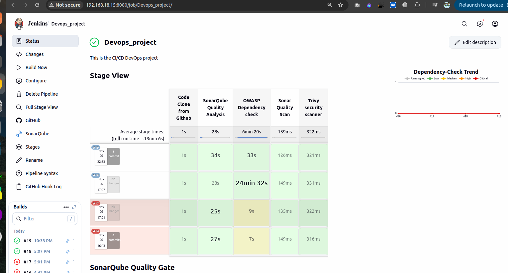


5. open your webapp `http://IP_address:5000/`
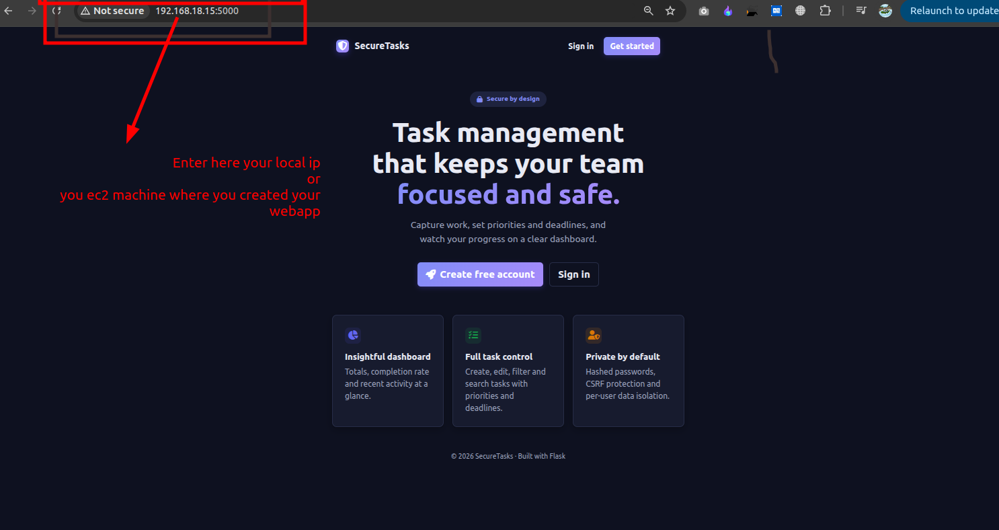


**Result:** Jenkins successfully sends application code to SonarQube for automated code quality and security analysis.

### Official References

- [SonarQube Official Jenkins Integration Guide](https://docs.sonarsource.com/sonarqube-server/analyzing-source-code/ci-integration/jenkins-integration/)
- [Jenkins SonarQube Scanner Documentation](https://www.jenkins.io/doc/pipeline/steps/sonar/)

---
